# SVM Employee Attrition Project

## Abstract

This project builds a leakage-safe machine-learning pipeline that estimates whether an employee may resign within the next quarter. It compares Logistic Regression, Random Forest, and a tuned Support Vector Machine (SVM), then turns the selected model's probabilities into a human-reviewed HR retention scorecard.

## Problem statement

Organizations need an early-warning view of retention risk so that HR teams can offer timely, supportive interventions. The dashboard is decision support only: it must not be used as an automated employment decision or as a judgment of employee value.

## Live Demo

<ADD STREAMLIT LINK HERE>

## Architecture

```mermaid
flowchart LR
    A[Raw CSV or synthetic data] --> B[Validation and EDA]
    B --> C[Feature engineering]
    C --> D[Stratified train/test split]
    D --> E[ColumnTransformer preprocessing]
    E --> F[Balanced candidate models]
    F --> G[Cross-validation and SVM tuning]
    G --> H[Evaluation and explainability]
    H --> I[Retention scorecard CSV]
    I --> J[Streamlit dashboard]
```



## Tech stack

- Python 3.11
- Streamlit and Plotly for the dashboard
- pandas and NumPy for data preparation
- scikit-learn and imbalanced-learn for modeling
- SHAP, Matplotlib, and Seaborn for explainability and figures
- joblib for model persistence

## Folder structure

```text
app/                 Streamlit dashboard and UI components
data/raw/            Input employee CSV
models/              Persisted trained model
notebooks/            Exploratory notebooks
reports/              Metrics, scorecard, and generated figures
src/                 Data, feature, training, evaluation, and prediction code
tests/               Automated tests
requirements.txt     Pinned runtime dependencies
runtime.txt          Streamlit Community Cloud Python version
```

## Setup and run on Windows

```powershell
py -3.11 -m venv .venv
.\.venv\Scripts\Activate.ps1
python -m pip install -r requirements.txt
python -m src.train
streamlit run app/streamlit_app.py
```

The dashboard opens at `http://localhost:8501`. It provides five tabs: Overview, Risk Analysis, Employee Scorecard, Employee Drill-down, and Model Performance.

To score a compatible CSV:

```powershell
python -m src.predict data/raw/employee_attrition.csv --output reports/retention_scorecard.csv
```

If the raw CSV is absent, the loader creates reproducible synthetic records.

## Results

| Model | ROC-AUC | PR-AUC | Recall | F1 |
|---|---:|---:|---:|---:|
| Logistic Regression | 0.99995 | 0.99974 | 1.000 | 0.943 |
| Random Forest | 0.98109 | 0.90362 | 0.793 | 0.810 |
| Tuned SVM | 0.99982 | 0.99905 | 0.880 | 0.936 |

Metrics are from the saved training run in `reports/metrics.json`. The selected SVM threshold prioritizes recall for the resign class and therefore increases human-review workload.

## Screenshots

- `reports/figures/dashboard_overview.png`
- `reports/figures/risk_analysis.png`
- `reports/figures/employee_scorecard.png`
- `reports/figures/model_performance.png`

## Limitations and fairness

The data is synthetic, so the results demonstrate the pipeline, not real-world accuracy. Validate calibration, drift, and subgroup performance before using real data. Protected attributes are not used in modeling, but excluding them does not by itself guarantee fairness because other variables can act as proxies. Use supportive, voluntary interventions and human review.

## Author

**[Your Name]**
